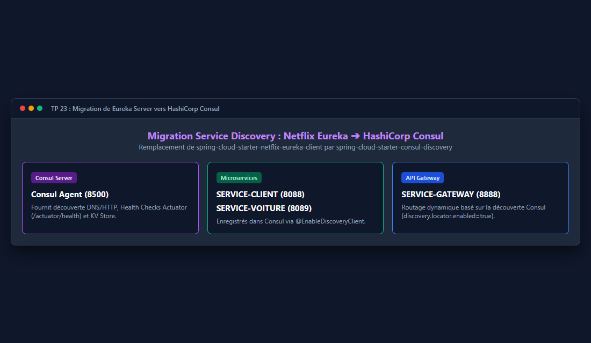
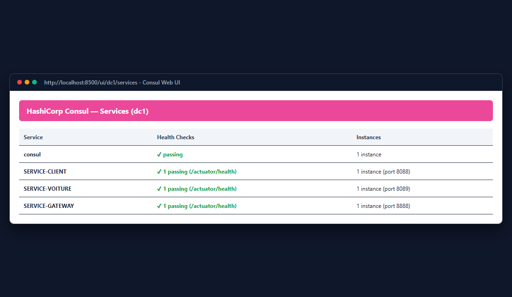

# TP 23 : Migration de Eureka vers HashiCorp Consul

> **Cours :** Architecture Microservices : Conception, Déploiement et Orchestration  
> **Auteur :** Moad Moussaoui

---

## 🎯 Objectifs du TP

1. Comprendre la logique d'une migration de *Service Discovery* (**Netflix Eureka ➔ HashiCorp Consul**).
2. Remplacer `spring-cloud-starter-netflix-eureka-client` par `spring-cloud-starter-consul-discovery`.
3. Configurer les *Health Checks* Actuator (`/actuator/health`) et l'enregistrement des services dans Consul (`localhost:8500`).
4. Conteneuriser et orchestrer Consul avec Docker Compose (`docker-compose.yml`).

---

## 🏗️ Architecture Après Migration



| Microservice | Port | Rôle |
| :--- | :--- | :--- |
| **`consul` (Docker)** | `8500` | Serveur de découverte HashiCorp Consul (Service Registry + Health Checks + KV Store) |
| **`service-client`** | `8088` | API REST `/api/clients` enregistrée sous `SERVICE-CLIENT` dans Consul |
| **`service-voiture`** | `8089` | API REST `/api/voitures` consommant `SERVICE-CLIENT` via `RestTemplate` `@LoadBalanced` |
| **`gateway-service`** | `8888` | API Gateway Spring Cloud routant dynamiquement via la découverte Consul |

---

## ⚙️ Changements Clés de Migration

### 1. Dépendance Maven (`pom.xml`)
Suppression de `spring-cloud-starter-netflix-eureka-client` et ajout de :
```xml
<dependency>
    <groupId>org.springframework.cloud</groupId>
    <artifactId>spring-cloud-starter-consul-discovery</artifactId>
</dependency>
<dependency>
    <groupId>org.springframework.boot</groupId>
    <artifactId>spring-boot-starter-actuator</artifactId>
</dependency>
```

### 2. Configuration (`application.yml`)
```yaml
spring:
  application:
    name: SERVICE-CLIENT
  cloud:
    consul:
      host: localhost
      port: 8500
      discovery:
        service-name: SERVICE-CLIENT
        health-check-path: /actuator/health
```

---

## 📸 Validation dans Consul UI (`http://localhost:8500`)



---

## 🚀 Exécution

```bash
# 1. Démarrer Consul via Docker Compose
docker-compose up -d

# 2. Valider la compilation et les tests unitaires
mvn test

# 3. Démarrer les microservices
cd service-client && mvn spring-boot:run
cd service-voiture && mvn spring-boot:run
cd gateway-service && mvn spring-boot:run
```
